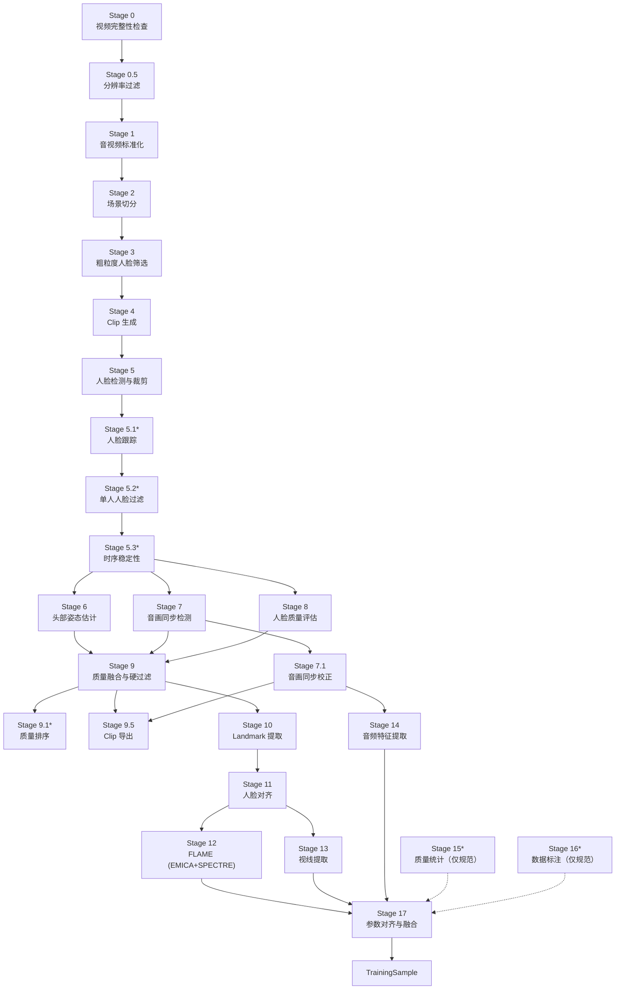

# Face_Pipeline_V2 — 技术参考文档

Face_Pipeline_V2 综合技术参考文档。本文档根据实际源码（`face_pipeline_v2/`、`configs/config.yaml`、`scripts/`）整理生成，反映 **Stage 12 `emica_ppu_env`** 变更完成后的当前状态（jaw_pose 最终采用 EMICA 方案）。

- **数据模型来源：** `face_pipeline_v2/data/models.py`（30 个 dataclass，已通过 AST 校验）。
- **Stage 来源：** `face_pipeline_v2/stages/`。
- **配置来源：** `configs/config.yaml`。
- **Stage 12 环境矩阵：** 见 [Stage 12 `emica_ppu_env` 环境](#5-stage-12-emica_ppu_env-环境矩阵)。

---

## 1. Pipeline 概览

流水线采用**基于 Stage 的架构**，输入原始视频，最终输出面向说话人视频 / 人脸流水线训练的、按 clip 组织的多模态训练样本（视觉 + 音频）。

`config.yaml` 中的 `pipeline_mode` 支持两种编排模式：

| 模式 | 执行链 | 说明 |
| --- | --- | --- |
| `open_domain`（默认） | Stage 0 → 0.5 → 1 → 2 → 3 → 4 → 5 → (5.x) → 6/7/7.1/8/9 → 9.x → 10 → 11 → 12/13/14 → 17 | 完整质量过滤 |
| `dataset` | Stage 0 → 5 → 10 → 11 → 12 → 13 → 14 → 17 | 跳过质量相关 Stage（面向高质量数据集） |

### Mermaid 流程图

图例：`*` = 增强 / 可选阶段；虚线 = 仅规范说明（未实现）。Stage 15 与 Stage 16 的阶段目录为空（仅含 `__init__.py`），视为仅规范说明的占位阶段。

---

## 2. 模型清单

| # | 模型 / 方法 | 使用阶段 | Wrapper（如有） | 权重 / 路径 | 默认设备 |
| --- | --- | --- | --- | --- | --- |
| 1 | FFprobe / FFmpeg（CLI） | Stage 0、1、7.1、9.5 | —（subprocess） | 系统 `ffprobe` / `ffmpeg` | — |
| 2 | PySceneDetect `ContentDetector` | Stage 2 | —（scenedetect） | —（threshold 27.0，min_scene_len 15） | CPU |
| 3 | SCRFD | Stage 3、5 | `models/wrappers/scrfd.py`（`SCRFDWrapper`） | `models/SCRFD` | cuda / auto |
| 4 | ByteTrack | Stage 5.1（增强） | `models/wrappers/bytetrack.py`（`ByteTrackWrapper`） | —（阈值来自配置） | CPU |
| 5 | 6DRepNet | Stage 6 | `models/wrappers/sixdrepnet.py` | `models/6DRepNet` | cuda / auto |
| 6 | SyncNet | Stage 7 | `models/wrappers/syncnet.py` | `models/syncnet/syncnet_v2.model` | cpu |
| 7 | HyperIQA | Stage 8 | `models/wrappers/hyperiqa.py` | `models/HyperIQA` | cuda / auto |
| 8 | InsightFace `2d106det` | Stage 10 | `models/wrappers/insightface_landmark.py` | `models/insightface/2d106det.onnx` | auto |
| 9 | EMICA | Stage 12 | `models/wrappers/emica.py`（`EMICAWrapper`） | `models/EMICA/EMICA-CVT_flame2020_notexture/checkpoints/model-epoch=38-val/loss_total=3.88806534.ckpt` | cuda |
| 10 | SPECTRE | Stage 12 | `models/wrappers/spectre.py`（`SPECTREWrapper`） | `third_party/inferno/spectre/spectre/data/spectre_model.tar` | cuda |
| 11 | MediaPipe Face Landmarker | Stage 13 | —（mediapipe.tasks） | `models/mediapipe/face_landmarker.task` | cpu / gpu |
| 12 | HuBERT（中文） | Stage 14 | `models/wrappers/hubert.py`（`HuBERTWrapper`） | `models/hubert/chinese-hubert-base` | auto |

说明：

- `models/wrappers/wav2vec2.py` 同样存在，但**并非** Stage 14 的默认后端 —— Stage 14 使用 HuggingFace
  `transformers` 加载 HuBERT（fairseq HuBERT checkpoint 与 Python 3.12 不兼容）。
- Stage 15（Pandas）与 Stage 16（Whisper/FairFace/CLIP）仅在规范中定义了模型，**尚未实现**。
- Stage 17 为纯数据处理（无模型推理）。

### 2.2 Pipeline 运行效率

以下运行效率数据来自对 `chinese_talking_videos_bilibili` 数据集的一轮完整批量运行（`open_domain` 模式，含 Stage 6–9.5 质量过滤）的实测统计：共 **3548** 个输入视频、最终 **595** 个 PASS（约 16.8%），批次总 wall-clock 约 **12 小时 19 分**。Stage 0–11 按**视频**统计，Stage 12–17 按 **clip** 统计（595 个视频共切出 625 个 clip）。

**（1）各阶段样本漏斗**

| 阶段 | 到达样本数 | 较上一步减少 | 说明 |
| --- | --- | --- | --- |
| Stage 0 输入 | 3548 | — | 全部输入视频 |
| Stage 2 场景切分 | 3537 | -11 | Stage 0.5/1/2 阶段掉 11 |
| Stage 4 滑窗切 clip | 2692 | -845 | Stage 3 粗筛掉 845（约 24%） |
| Stage 10（通过质量过滤） | 595 | -2097 | Stage 8/9 质量过滤掉 2097（约 78%） |
| Stage 12–17（按 clip） | 625 | — | 595 个视频共切出 625 个 clip |

**（2）Stage 0–11 逐阶段耗时（按视频，单位：秒）**

| 阶段 | n | 均值 | 中位数 | p90 | 最大 |
| --- | --- | --- | --- | --- | --- |
| Stage 0（FFprobe 完整性检查） | 3548 | 0.70 | 0.56 | 1.14 | 8.90 |
| Stage 0.5（分辨率过滤） | 3548 | 0.00 | 0.00 | 0.00 | 0.00 |
| Stage 1（FFmpeg 标准化） | 3548 | 6.98 | 4.46 | 11.90 | 117.54 |
| Stage 2（PySceneDetect 场景切分） | 3537 | 3.10 | 2.40 | 4.82 | 40.09 |
| Stage 3（SCRFD 粗筛） | 3537 | 8.16 | 6.65 | 13.10 | 34.55 |
| Stage 4（滑窗切 clip） | 2692 | 0.00 | 0.00 | 0.00 | 0.01 |
| Stage 5（SCRFD 检测/裁剪） | 2692 | 43.18 | 26.46 | 123.20 | 308.48 |
| Stage 5.1/5.2/5.3（跟踪/单脸/时序） | 2692 | 0.00 | 0.00 | 0.00 | 0.00 |
| Stage 6（6DRepNet 头部姿态） | 2692 | 56.35 | 33.29 | 127.03 | 250.61 |
| Stage 7（SyncNet 音画同步） | 2692 | 15.85 | 8.92 | 34.91 | 66.36 |
| Stage 7.1（音画同步校正） | 2692 | 0.13 | 0.15 | 0.20 | 0.72 |
| Stage 8（HyperIQA 质量评估） | 2692 | 82.80 | 49.96 | 231.70 | 411.05 |
| Stage 9（质量融合/硬过滤） | 2692 | 0.00 | 0.00 | 0.00 | 0.02 |
| Stage 9.5（Clip 导出） | 2692 | 0.46 | 0.00 | 2.19 | 7.89 |
| Stage 10（InsightFace 关键点） | 595 | 18.76 | 6.04 | 52.07 | 172.42 |
| Stage 11（仿射对齐） | 595 | 3.09 | 3.43 | 5.34 | 8.50 |

**（3）Stage 12–17 逐阶段耗时（按 clip，n≈625，单位：秒）**

| 阶段 | 指标 | 均值 | 中位数 | p90 | 最大 |
| --- | --- | --- | --- | --- | --- |
| Stage 12（EMICA，GPU） | 模型加载 | 9.94 | 9.20 | 14.60 | 19.40 |
| Stage 12（EMICA，GPU） | 推理 | 26.68 | 20.75 | 56.20 | 216.60 |
| Stage 12（EMICA，GPU） | 吞吐 | 0.0297 s/帧（≈33.6 fps） | 0.0200 s/帧 | — | — |
| Stage 13（MediaPipe gaze，CPU） | 单 clip 处理 | 31.41 | 43.04 | 48.78 | 65.05 |
| Stage 14（HuBERT 音频，CPU） | 单 clip 处理 | 7.75 | 7.93 | 10.90 | 21.59 |
| Stage 17（参数对齐与融合） | 单 clip 处理 | 0.07 | 0.10 | 0.12 | 0.32 |
| 生产导出（export） | 单视频 | <1 | — | — | — |

运行效率结论：

- **主要瓶颈（耗时随帧数线性增长）**：Stage 8（HyperIQA 质量评估，~83 s）为最重环节，其次为 Stage 6（6DRepNet 姿态，~56 s）与 Stage 5（SCRFD 检测/裁剪，~43 s）；Stage 13（gaze）虽为 CPU 推理（MediaPipe 在 GPU EGL 初始化失败时回退 XNNPACK CPU），但约含 ~8 s 的模型加载开销。
- **可优化开销**：Stage 12（EMICA）推理本身较快（≈33.6 fps），但**每个 clip 都会重新加载模型**（~10 s/clip）；Stage 13 / 14 同理，模型加载在每个 clip 重复发生。多 clip 视频下这部分为显著的固定开销。
- **零成本环节**：Stage 0.5、4、5.1、5.2、5.3、9、11、17 及生产导出基本为规则判定 / 元数据处理，耗时 <1 s，不属于优化方向。
- **模式差异**：`dataset` 模式跳过 Stage 6/7/7.1/8/9/9.5，可省去这批 run 中最重的三块（Stage 8 ~83 s + Stage 6 ~56 s + Stage 7 ~16 s ≈ 单视频省 ~155 s），是 `dataset` 模式显著快于 `open_domain` 的根本原因。

---

## 3. 数据模型（30 个 dataclass）

字段按 `face_pipeline_v2/data/models.py` 中的声明顺序排列（保持原始顺序）。可选字段在「类型」列以 `Optional[...]` 标注；带默认值的字段在「字段说明」中注明。

### 3.1 Stage 0–1 的 dataclass

#### Stage 0 — `VideoInfo`（视频基础信息）

| 字段名 | 中文名 | 类型 | 字段说明 | 样例 |
| --- | --- | --- | --- | --- |
| `video_id` | 视频唯一 ID | `str` | 视频数据唯一标识 | `"video_001"` |
| `video_path` | 视频路径 | `Path` | 原始视频文件路径 | `Path("data/raw/video_001.mp4")` |
| `original_fps` | 原始帧率 | `float` | 输入视频原始 FPS | `29.97` |
| `width` | 视频宽度 | `int` | 原始视频宽度（像素） | `1920` |
| `height` | 视频高度 | `int` | 原始视频高度（像素） | `1080` |
| `duration` | 视频时长 | `float` | 视频总时长（秒） | `120.5` |
| `total_frames` | 总帧数 | `int` | 视频总帧数量 | `3611` |
| `codec` | 编码格式 | `str` | 视频编码格式 | `"h264"` |
| `has_audio` | 是否含音频 | `bool` | 是否存在音频流 | `True` |

#### Stage 0.5 — `ResolutionValidationInfo`（分辨率校验信息）

| 字段名 | 中文名 | 类型 | 字段说明 | 样例 |
| --- | --- | --- | --- | --- |
| `width` | 视频宽度 | `int` | 原始视频宽度 | `1280` |
| `height` | 视频高度 | `int` | 原始视频高度 | `720` |
| `min_width` | 最小宽度 | `int` | 最低分辨率要求宽度 | `720` |
| `min_height` | 最小高度 | `int` | 最低分辨率要求高度 | `576` |
| `is_valid` | 是否通过 | `bool` | 分辨率达标则可进入 Stage 1 | `True` |
| `reject_reason` | 拒绝原因 | `Optional[str]` | 如 `"resolution_too_low"`；通过时为 `None` | `None` |

#### Stage 1 — `StandardizedVideoInfo`（标准化视频信息）

| 字段名 | 中文名 | 类型 | 字段说明 | 样例 |
| --- | --- | --- | --- | --- |
| `video_path` | 标准化视频路径 | `Path` | FFmpeg 处理后视频 | `Path("outputs/stage1/video_001.mp4")` |
| `audio_path` | 标准化音频路径 | `Path` | 提取后的音频 | `Path("outputs/stage1/video_001.wav")` |
| `target_fps` | 标准帧率 | `int` | 默认 25 FPS | `25` |
| `resolution` | 标准分辨率 | `Tuple[int, int]` | 统一输出尺寸 (width, height) | `(1920, 1080)` |
| `codec` | 编码格式 | `str` | 标准视频编码 | `"h264"` |

#### Stage 1 — `AudioInfo`（音频信息）

| 字段名 | 中文名 | 类型 | 字段说明 | 样例 |
| --- | --- | --- | --- | --- |
| `audio_path` | 音频路径 | `Path` | 提取后的原始音频路径 | `Path("outputs/stage1/video_001.wav")` |
| `sample_rate` | 采样率 | `int` | 默认 16000 Hz | `16000` |
| `duration` | 音频长度 | `float` | 音频持续时间（秒） | `120.5` |
| `channels` | 声道数 | `int` | 音频声道数量 | `1` |

### 3.2 Stage 2–5 的 dataclass

#### Stage 2 — `SceneInfo`（场景信息）

| 字段名 | 中文名 | 类型 | 字段说明 | 样例 |
| --- | --- | --- | --- | --- |
| `scene_id` | 场景 ID | `str` | Scene 唯一标识 | `"scene_001"` |
| `video_id` | 视频 ID | `str` | 所属视频 | `"video_001"` |
| `start_frame` | 起始帧 | `int` | Scene 开始位置 | `0` |
| `end_frame` | 结束帧 | `int` | Scene 结束位置 | `299` |
| `start_time` | 开始时间 | `float` | Scene 开始时间（秒） | `0.0` |
| `end_time` | 结束时间 | `float` | Scene 结束时间（秒） | `12.0` |
| `duration` | Scene 时长 | `float` | Scene 持续时间（秒） | `12.0` |
| `coarse_face_info` | 粗筛人脸信息 | `Optional[CoarseFaceInfo]` | Stage 3 SCRFD 检测结果 | `None` |
| `filter_result` | 过滤结果 | `Optional[SceneFilterResult]` | Stage 3 过滤决策 | `None` |

#### Stage 3 — `CoarseFaceInfo`（粗筛人脸检测结果）

| 字段名 | 中文名 | 类型 | 字段说明 | 样例 |
| --- | --- | --- | --- | --- |
| `sampled_frame_count` | 采样帧数 | `int` | SCRFD 实际检测的帧数 | `30` |
| `face_detect_ratio` | 人脸检测率 | `float` | 检测到人脸帧数 / 采样帧数 | `0.93` |
| `single_face_ratio` | 单人脸比例 | `float` | 单人脸帧数 / 检测到人脸帧数 | `0.97` |
| `avg_face_confidence` | 平均置信度 | `float` | 所有人脸检测的平均置信度 | `0.87` |
| `max_face_count` | 最大人脸数 | `int` | 单帧检测到的最大人脸数量 | `1` |

#### Stage 3 — `SceneFilterResult`（场景过滤决策）

| 字段名 | 中文名 | 类型 | 字段说明 | 样例 |
| --- | --- | --- | --- | --- |
| `passed` | 是否通过 | `bool` | True = 通过所有过滤规则 | `True` |
| `reject_reasons` | 拒绝原因列表 | `Tuple[str, ...]` | 支持多个原因（too_short / no_face / multi_face / low_confidence） | `("too_short",)` |

#### Stage 4 — `ClipInfo`（Clip 信息）

| 字段名 | 中文名 | 类型 | 字段说明 | 样例 |
| --- | --- | --- | --- | --- |
| `clip_id` | Clip 编号 | `str` | 当前 Clip 唯一 ID | `"video_001_clip_000"` |
| `scene_id` | Scene 编号 | `str` | 来源 Scene | `"scene_001"` |
| `video_id` | 视频 ID | `str` | 来源视频 | `"video_001"` |
| `start_frame` | 起始帧 | `int` | Clip 开始帧 | `0` |
| `end_frame` | 结束帧 | `int` | Clip 结束帧 | `199` |
| `start_time` | 起始时间 | `float` | Clip 开始时间（秒） | `0.0` |
| `end_time` | 结束时间 | `float` | Clip 结束时间（秒） | `8.0` |
| `frame_count` | 帧数量 | `int` | Clip 包含帧数量 | `200` |
| `duration` | Clip 长度 | `float` | Clip 持续时间（秒） | `8.0` |

#### Stage 5.2 — `SingleFaceIdentityResult`（单人脸身份一致性过滤结果）

| 字段名 | 中文名 | 类型 | 字段说明 | 样例 |
| --- | --- | --- | --- | --- |
| `passed` | 是否通过 | `bool` | anomaly_ratio ≤ max_identity_anomaly_ratio | `True` |
| `main_track_id` | 主导 track | `Optional[str]` | 出现次数最多的 track_id | `"3"` |
| `total_frames` | 总帧数 | `int` | 参与统计的总帧数 | `200` |
| `anomaly_frames` | 异常帧数 | `int` | empty + multi + identity_switch 帧累计数 | `5` |
| `anomaly_ratio` | 异常帧比例 | `float` | anomaly_frames / total_frames | `0.025` |
| `reject_reasons` | 拒绝原因 | `Tuple[str, ...]` | empty_face / multi_face / identity_switch | `()` |

#### Stage 5.3 — `TemporalStabilityResult`（时间稳定性过滤结果）

| 字段名 | 中文名 | 类型 | 字段说明 | 样例 |
| --- | --- | --- | --- | --- |
| `passed` | 是否通过 | `bool` | anomaly_ratio ≤ max_stability_anomaly_ratio | `True` |
| `average_center_motion` | 平均中心位移 | `float` | 相邻帧人脸中心点平均欧氏距离（像素） | `3.2` |
| `max_center_motion` | 最大中心位移 | `float` | 相邻帧最大跳跃（像素） | `11.5` |
| `average_scale_change` | 平均尺度变化 | `float` | 相邻帧人脸面积平均相对变化 | `0.03` |
| `max_scale_change` | 最大尺度变化 | `float` | 相邻帧最大相对面积变化 | `0.12` |
| `bbox_jump_count` | bbox 跳跃次数 | `int` | 超阈值的帧过渡数 | `3` |
| `anomaly_ratio` | 异常过渡比例 | `float` | bbox_jump_count / total_transitions | `0.02` |
| `reject_reasons` | 拒绝原因 | `Tuple[str, ...]` | center_motion_abnormal / scale_abnormal / bbox_jump_exceeded | `()` |

#### Stage 5 — `FaceSequence`（人脸时间序列）

| 字段名 | 中文名 | 类型 | 字段说明 | 样例 |
| --- | --- | --- | --- | --- |
| `clip_id` | Clip 编号 | `str` | 所属 Clip 唯一标识 | `"video_001_clip_000"` |
| `video_id` | 视频 ID | `str` | 来源视频 | `"video_001"` |
| `frames` | 帧序列 | `Tuple[FrameInfo, ...]` | Clip 内所有帧人脸检测结果，按 frame_index 升序 | `(FrameInfo(...), ...)` |
| `identity_result` | 身份一致性结果 | `Optional[SingleFaceIdentityResult]` | Stage 5.2 过滤结果，None = 未过滤 | `None` |
| `stability_result` | 稳定性结果 | `Optional[TemporalStabilityResult]` | Stage 5.3 过滤结果，None = 未过滤 | `None` |

#### Stage 5 — `FrameInfo`（帧信息）

| 字段名 | 中文名 | 类型 | 字段说明 | 样例 |
| --- | --- | --- | --- | --- |
| `frame_index` | 帧编号 | `int` | 视频全局帧索引 | `0` |
| `clip_id` | Clip 编号 | `str` | 所属 Clip | `"video_001_clip_000"` |
| `timestamp` | 时间戳 | `float` | 当前帧时间（秒） | `0.0` |
| `image_path` | 图片路径 | `Path` | 当前帧存储位置 | `Path("outputs/frames/.../frame_000000.jpg")` |
| `faces` | 检测到的人脸列表 | `Tuple[FaceInfo, ...]` | 按面积降序排列 | `(FaceInfo(...),)` |

#### Stage 5 — `FaceInfo`（人脸信息）

| 字段名 | 中文名 | 类型 | 字段说明 | 样例 |
| --- | --- | --- | --- | --- |
| `frame_index` | 帧编号 | `int` | 当前人脸对应帧 | `0` |
| `face_id` | 人脸 ID | `str` | 当前检测人脸编号（单帧内唯一） | `"face_0"` |
| `bbox` | 人脸框 | `Tuple[float, float, float, float]` | SCRFD 原始检测框 (x1, y1, x2, y2) | `(120.0, 80.0, 400.0, 360.0)` |
| `landmark_5` | 五点关键点 | `Tuple[float, ...]` | SCRFD 输出 5 点（10 个 float） | `(120.5, 90.2, ...)` |
| `confidence` | 检测置信度 | `float` | 检测可靠性 | `0.95` |
| `face_crop_path` | 裁剪路径 | `Path` | expanded bbox 的 raw crop 结果 | `Path("outputs/face_crop/.../face_0.jpg")` |
| `track_id` | 跟踪 ID | `Optional[str]` | 跨帧身份标识（Stage 5.1 ByteTrack），None = 未跟踪 | `"3"` |
| `expanded_bbox` | 扩展后裁剪框 | `Tuple[float, float, float, float]` | expand_ratio 放大后的实际 crop bbox (x1, y1, x2, y2) | `(100.0, 60.0, 420.0, 380.0)` |

### 3.3 Stage 10–11 的 dataclass

#### Stage 10 — `LandmarkInfo`（关键点信息）

| 字段名 | 中文名 | 类型 | 字段说明 | 样例 |
| --- | --- | --- | --- | --- |
| `clip_id` | Clip 编号 | `str` | 所属 Clip 唯一标识 | `"video_001_clip_000"` |
| `frame_index` | 帧编号 | `int` | 对应视频帧 | `0` |
| `face_id` | 人脸 ID | `str` | 对应检测人脸 | `"face_0"` |
| `timestamp` | 时间戳 | `float` | 当前帧时间（秒） | `0.0` |
| `landmarks_106` | 106 点关键点 | `Tuple[float, ...]` | 展平坐标 [x0, y0, …, x105, y105] 共 212 个 float，已转换至原始 frame 坐标系 | `(120.0, 90.0, ...)` |
| `image_width` | 原始图像宽度 | `int` | 用于坐标校验 | `1920` |
| `image_height` | 原始图像高度 | `int` | 用于坐标校验 | `1080` |

#### Stage 11 — `AlignedFaceInfo`（人脸对齐信息）

| 字段名 | 中文名 | 类型 | 字段说明 | 样例 |
| --- | --- | --- | --- | --- |
| `clip_id` | Clip 编号 | `str` | 所属 Clip 唯一标识 | `"video_001_clip_000"` |
| `frame_index` | 帧编号 | `int` | 对应视频帧 | `0` |
| `face_id` | 人脸 ID | `str` | 对应检测人脸 | `"face_0"` |
| `timestamp` | 时间戳 | `float` | 当前帧时间（秒） | `0.0` |
| `aligned_face_path` | 对齐后人脸路径 | `Path` | 标准化 Face 图像 (256×256) | `Path("outputs/aligned/.../face_0.jpg")` |
| `affine_matrix` | 仿射变换矩阵 | `Tuple[float, ...]` | 2×3 矩阵展平 [a, b, tx, c, d, ty]，用于 cv2.warpAffine | `(1.0, 0.0, 10.0, 0.0, 1.0, 20.0)` |
| `original_image_size` | 原始图像尺寸 | `Tuple[int, int]` | (height, width)，用于逆变换还原目标尺寸 | `(1080, 1920)` |
| `aligned_resolution` | 对齐分辨率 | `Tuple[int, int]` | 标准人脸输出尺寸 | `(256, 256)` |

### 3.4 Stage 6–9 的 dataclass

#### Stage 6 — `PoseInfo`（姿态信息）

| 字段名 | 中文名 | 类型 | 字段说明 | 样例 |
| --- | --- | --- | --- | --- |
| `frame_index` | 帧编号 | `int` | 对应视频帧 | `0` |
| `face_id` | 人脸 ID | `str` | 对应检测人脸 | `"face_0"` |
| `yaw` | 水平旋转角 | `float` | Yaw angle（度） | `-10.5` |
| `pitch` | 垂直旋转角 | `float` | Pitch angle（度） | `5.2` |
| `roll` | 平面旋转角 | `float` | Roll angle（度） | `1.3` |
| `confidence` | 姿态置信度 | `float` | 模型输出置信度（默认 1.0） | `0.98` |

#### Stage 6 — `PoseSequence`（姿态序列）

| 字段名 | 中文名 | 类型 | 字段说明 | 样例 |
| --- | --- | --- | --- | --- |
| `clip_id` | Clip 编号 | `str` | 所属 Clip | `"video_001_clip_000"` |
| `poses` | 姿态列表 | `Tuple[PoseInfo, ...]` | 逐帧姿态估计结果，按 frame_index 升序 | `(PoseInfo(...), ...)` |

#### Stage 7 — `AVSyncInfo`（音画同步信息）

| 字段名 | 中文名 | 类型 | 字段说明 | 样例 |
| --- | --- | --- | --- | --- |
| `clip_id` | Clip 编号 | `str` | 检测的 Clip | `"video_001_clip_000"` |
| `offset` | 偏移帧数 | `int` | 检测到的音画偏移 | `3` |
| `sync_lse_c` | LSE-C | `float` | median(distance) - min(distance)，越高越可信 | `5.87` |
| `sync_lse_d` | LSE-D | `float` | min(distance)，越低同步越好 | `1.23` |
| `median_distance` | 中位距离 | `float` | frame-audio pairwise distance 中位数（debug 用，默认 0.0） | `2.45` |
| `start_frame` | 起始帧 | `Optional[int]` | Clip 在标准化视频中的起始帧（Stage 4 提供） | `0` |
| `end_frame` | 结束帧 | `Optional[int]` | Clip 在标准化视频中的结束帧（Stage 4 提供） | `199` |
| `fps` | 帧率 | `Optional[float]` | 检测所用帧率 | `25.0` |
| `duration` | Clip 时长 | `Optional[float]` | (end_frame - start_frame) / fps | `8.0` |
| `timestamp` | 起始时间戳 | `Optional[float]` | start_frame / fps，即 ffmpeg -ss 裁剪起点 | `0.0` |

#### Stage 7 — `CorrectedAudioInfo`（修正后音频信息）

| 字段名 | 中文名 | 类型 | 字段说明 | 样例 |
| --- | --- | --- | --- | --- |
| `corrected_audio_path` | 修正后音频路径 | `Path` | Offset 校正后的 Audio 文件 | `Path("outputs/av_sync/video_001_clip_000_corrected.wav")` |
| `original_audio_path` | 原始音频路径 | `Path` | Stage 1 输出 Audio | `Path("outputs/stage1/video_001.wav")` |
| `offset` | 音频偏移量 | `int` | SyncNet 检测得到的帧偏移 | `3` |
| `corrected_timestamp` | 修正后时间轴 | `Tuple[float, ...]` | 对齐后的 Audio 时间信息 | `(0.0, 0.04, ...)` |
| `sync_score` | 同步评分 | `float` | 音画同步质量 | `5.87` |

#### Stage 7.1 — `AVAlignmentInfo`（音画同步校正信息）

| 字段名 | 中文名 | 类型 | 字段说明 | 样例 |
| --- | --- | --- | --- | --- |
| `clip_id` | Clip 编号 | `str` | 被校正的 Clip | `"video_001_clip_000"` |
| `original_audio_path` | 原始音频路径 | `Path` | Stage 1 输出的标准化音频 | `Path("outputs/stage1/video_001.wav")` |
| `offset_frames` | 偏移帧数 | `int` | SyncNet 检测到的帧偏移 | `3` |
| `offset_ms` | 偏移毫秒 | `float` | offset_frames / fps * 1000 | `120.0` |
| `correction_applied` | 是否已校正 | `bool` | True = 已应用校正，False = 偏移在阈值内未校正 | `True` |
| `fps` | 帧率 | `float` | 视频帧率，用于 offset 换算 | `25.0` |
| `corrected_audio_path` | 校正后音频路径 | `Optional[Path]` | 仅当 correction_applied=True 时指向校正文件 | `Path(".../clip_corrected.wav")` |
| `aligned_audio_path` | 最终音频路径 | `Optional[Path]` | 下游 Stage 9.5/14 统一读取；None 表示严重错位不可用 | `Path(".../clip.wav")` |
| `alignment_status` | 音频对齐状态 | `str` | already_aligned / corrected / severe_offset_unavailable（默认 already_aligned） | `"corrected"` |
| `raw_audio_path` | clip 级原始音频路径 | `Optional[Path]` | 从 Stage 1 按 clip 窗口裁剪、未做 offset shift | `Path(".../clip_raw.wav")` |
| `clip_start` | Clip 起始时间 | `Optional[float]` | 裁剪窗口起点（秒） | `0.0` |
| `clip_duration` | Clip 时长 | `Optional[float]` | 裁剪窗口长度（秒） | `8.0` |

#### Stage 8 — `FaceQualityInfo`（人脸质量信息）

| 字段名 | 中文名 | 类型 | 字段说明 | 样例 |
| --- | --- | --- | --- | --- |
| `frame_index` | 帧编号 | `int` | 对应视频帧 | `0` |
| `face_id` | 人脸 ID | `str` | 对应检测人脸 | `"face_0"` |
| `quality_score` | 质量评分 | `float` | HyperIQA 质量分数，范围 0-100 | `86.5` |
| `confidence` | 置信度 | `float` | 模型预测置信度（默认 0.0） | `0.85` |

#### Stage 8 — `FaceQualitySequence`（质量序列）

| 字段名 | 中文名 | 类型 | 字段说明 | 样例 |
| --- | --- | --- | --- | --- |
| `clip_id` | Clip 编号 | `str` | 所属 Clip | `"video_001_clip_000"` |
| `qualities` | 质量列表 | `Tuple[FaceQualityInfo, ...]` | 逐帧质量评分，按 frame_index 升序 | `(FaceQualityInfo(...), ...)` |

#### Stage 9 — `QualityMetrics`（综合质量指标）

| 字段名 | 中文名 | 类型 | 字段说明 | 样例 |
| --- | --- | --- | --- | --- |
| `clip_id` | Clip 编号 | `str` | 被评估的 Clip | `"video_001_clip_000"` |
| `video_id` | 视频 ID | `str` | 来源视频 | `"video_001"` |
| `pose_score` | 姿态评分 | `float` | Stage 6 综合姿态分 | `0.9` |
| `sync_score` | 同步评分 | `float` | Stage 7 音画同步分 | `5.2` |
| `quality_score` | 质量评分 | `float` | Stage 8 人脸质量分 | `0.8` |
| `fusion_score` | 融合评分 | `float` | 综合质量评分 | `0.85` |
| `is_accepted` | 是否通过 | `bool` | 综合筛选结果 | `True` |
| `reject_reasons` | 拒绝原因 | `Tuple[str, ...]` | 未通过的 gate 名称列表，空 tuple 表示全部通过（默认 ()） | `()` |

#### Stage 9.1 — `QualityRankingInfo`（质量排序信息）

| 字段名 | 中文名 | 类型 | 字段说明 | 样例 |
| --- | --- | --- | --- | --- |
| `clip_id` | Clip 编号 | `str` | 被排序的 Clip | `"video_001_clip_000"` |
| `pose_score` | 姿态评分 | `float` | 来自 QualityMetrics | `0.9` |
| `sync_score` | 同步评分 | `float` | 来自 QualityMetrics | `5.2` |
| `face_quality_score` | 人脸质量评分 | `float` | 来自 QualityMetrics | `0.8` |
| `weighted_score` | 加权综合评分 | `float` | quality_ranking 权重计算的综合分 | `0.87` |
| `quality_level` | 质量等级 | `str` | excellent / good / normal | `"excellent"` |

> 注：`CorrectedAudioInfo` 为遗留类（`models.py` 标注为 Stage 7，当前代码无任何引用）；实际音画校正以 `AVAlignmentInfo`（Stage 7.1）为准。

### 3.5 Stage 12–17 的 dataclass

#### Stage 12 — `FLAMEFeature`（FLAME 参数）

| 字段名 | 中文名 | 类型 | 字段说明 | 样例 |
| --- | --- | --- | --- | --- |
| `frame_index` | 帧编号 | `int` | 对应视频帧 | `0` |
| `shapecode` | 形状参数 | `Tuple[float, ...]` | FLAME identity shape (300 dims) | `(0.1, -0.05, ...)` |
| `expcode` | 表情参数 | `Tuple[float, ...]` | FLAME expression (100 dims) | `(0.02, -0.01, ...)` |
| `jawpose` | 下巴姿态 | `Tuple[float, ...]` | jaw pose axis-angle (3 dims)，最终采用 pure EMICA jaw | `(0.02, -0.01, 0.0)` |
| `globalpose` | 全局姿态 | `Tuple[float, ...]` | global pose axis-angle (3 dims) | `(0.1, -0.2, 0.05)` |
| `cam` | 相机参数 | `Tuple[float, ...]` | orthographic camera (scale, tx, ty) (3 dims) | `(1.2, 0.0, 0.0)` |
| `eye_pose` | 眼球姿态 | `Tuple[float, ...]` | 固定 zeros，EMICA/SPECTRE 均不预测 (6 dims，默认全 0) | `(0.0, 0.0, 0.0, 0.0, 0.0, 0.0)` |
| `texcode` | 纹理参数 | `Optional[Tuple[float, ...]]` | FLAME texture / albedo (50 dims)，默认 None | `(0.5, 0.4, ...)` |
| `lightcode` | 光照参数 | `Optional[Tuple[float, ...]]` | spherical harmonics (27 dims = 9×3)，默认 None | `(0.3, 0.2, ...)` |
| `spectre_jawpose` | SPECTRE 原始下巴姿态 | `Optional[Tuple[float, ...]]` | raw SPECTRE jaw pose (3 dims)，调试审计用，SPECTRE 不可用时为 None | `(0.02, -0.01, 0.0)` |
| `emica_jawpose` | EMICA 原始下巴姿态 | `Optional[Tuple[float, ...]]` | raw EMICA jaw pose (3 dims)，与 jawpose 一致（冗余 debug 字段） | `(0.02, -0.01, 0.0)` |
| `timestamp` | 时间戳 | `float` | 当前帧时间（秒），用于 Stage14/17 多模态时间对齐（默认 0.0） | `0.0` |
| `clip_id` | Clip 编号 | `str` | 所属 Clip 唯一标识，用于 Stage17 样本溯源（默认 ""） | `"video_001_clip_000"` |

> 另有计算属性 `posecode`（= `globalpose`[3] + `jawpose`[3]，共 6 dims），非 dataclass 字段，不加列。

#### Stage 13 — `GazeFeature`（视线参数）

| 字段名 | 中文名 | 类型 | 字段说明 | 样例 |
| --- | --- | --- | --- | --- |
| `frame_index` | 帧编号 | `int` | 对应视频帧 | `0` |
| `timestamp` | 时间戳 | `float` | 当前帧时间（秒），用于 Stage14/17 多模态时间对齐 | `0.0` |
| `clip_id` | Clip 编号 | `str` | 所属 Clip 唯一标识，用于 Stage17 样本溯源 | `"video_001_clip_000"` |
| `left_eye` | 左眼视线 | `Tuple[float, float, float]` | 左眼方向向量 | `(0.1, -0.2, 0.9)` |
| `right_eye` | 右眼视线 | `Tuple[float, float, float]` | 右眼方向向量 | `(0.12, -0.18, 0.89)` |
| `gaze_vector` | 六维参数 | `Tuple[float, float, float, float, float, float]` | gaze_0_x/y/z + gaze_1_x/y/z | `(0.1, -0.2, 0.9, 0.12, -0.18, 0.89)` |

#### Stage 14 — `AudioFeature`（音频 Embedding）

| 字段名 | 中文名 | 类型 | 字段说明 | 样例 |
| --- | --- | --- | --- | --- |
| `timestamp` | 时间戳 | `float` | 修正后 Audio 时间（秒） | `0.0` |
| `feature` | 音频 Embedding | `Tuple[float, ...]` | HuBERT 输出 | `(0.01, -0.03, ...)` |
| `dimension` | 特征维度 | `int` | Embedding 维度（e.g. 768） | `768` |
| `source_audio` | 输入 Audio 来源 | `Path` | Corrected Audio 路径 | `Path("outputs/av_alignment/.../clip.wav")` |

#### Stage 15 — `StatisticsInfo`（质量统计信息）

| 字段名 | 中文名 | 类型 | 字段说明 | 样例 |
| --- | --- | --- | --- | --- |
| `video_id` | 视频 ID | `str` | 来源视频 | `"video_001"` |
| `total_frames` | 总帧数 | `int` | 处理总帧数 | `3611` |
| `accepted_frames` | 通过帧数 | `int` | 质量筛选通过帧数 | `3400` |
| `acceptance_rate` | 通过率 | `float` | 质量筛选通过比例 | `0.94` |
| `avg_quality_score` | 平均质量分 | `float` | 平均人脸质量评分 | `0.82` |
| `avg_pose_score` | 平均姿态分 | `float` | 平均姿态评分 | `0.88` |
| `avg_sync_score` | 平均同步分 | `float` | 平均音画同步评分 | `4.9` |

#### Stage 16 — `AnnotationInfo`（数据标注信息）

| 字段名 | 中文名 | 类型 | 字段说明 | 样例 |
| --- | --- | --- | --- | --- |
| `video_id` | 视频 ID | `str` | 来源视频 | `"video_001"` |
| `dataset_label` | 数据集标签 | `str` | 数据集分类标签 | `"open_domain"` |
| `video_type` | 视频类型 | `str` | e.g. studio, vlog, interview | `"studio"` |
| `quality_tier` | 质量等级 | `str` | 综合质量分级 | `"A"` |
| `metadata` | 元数据 | `Tuple[Tuple[str, str], ...]` | 附加标注信息键值对 | `(("speaker", "zh"),)` |

#### Stage 17 — `TrainingSample`（最终训练样本）

> clip 级时间序列样本包：每个 Stage4 clip 生成一个样本（sample_id := clip_id），各模态按同一帧轴 T 对齐。

| 字段名 | 中文名 | 类型 | 字段说明 | 样例 |
| --- | --- | --- | --- | --- |
| `clip_id` | 样本 / Clip ID | `str` | 每个 Stage4 clip 生成一个训练样本（默认 ""） | `"video_001_clip_000"` |
| `visual_feature` | 视觉特征 | `np.ndarray` | [T,112] float32 = expression[100] + pose[6] + gaze[6] | `np.array([[...]])` |
| `audio_feature` | 音频特征 | `np.ndarray` | [T,768] float32，与视觉帧按 timestamp 最近邻对齐 | `np.array([[...]])` |
| `frame_index` | 视频帧号 | `np.ndarray` | [T] int32，以 FLAME 的 frame_index 为锚点 | `np.array([0, 1, 2, ...])` |
| `timestamps` | 时间戳 | `np.ndarray` | [T] float32，标准化视频绝对秒 | `np.array([0.0, 0.04, ...])` |
| `valid_length` | 有效帧数 | `Optional[int]` | 三模态齐全且 |Δt| 合格的帧数；None 表示未标定，显式 0 表示「全缺失样本」 | `8` |
| `dropout_mask` | 缺失帧掩码 | `np.ndarray` | [T] bool；True 表示该帧经 forward-fill 补齐，训练侧可丢弃 | `np.array([False, ...])` |
| `audio_match_idx` | 音频匹配索引 | `np.ndarray` | [T] int32，每帧对应原始 audio feature 索引；-1 表示未匹配 | `np.array([0, 0, 1, ...])` |
| `metadata` | 元数据 | `Union[Dict[str, Any], Tuple[Tuple[str, str], ...]]` | 溯源字段（sample_id/clip_id/video_id/scene_id/fps/start_frame 等），兼容旧 tuple 自动转 dict | `{"sample_id": "video_001_clip_000", "video_id": "video_001"}` |
| `sample_id` | [DEPRECATED] 旧样本 ID | `Optional[str]` | 旧单帧样本 ID，兼容旧调用；新代码用 clip_id | `None` |
| `video_clip` | [DEPRECATED] 旧视频 Clip 路径 | `Optional[Path]` | 兼容旧调用 | `None` |
| `face_sequence` | [DEPRECATED] 旧人脸序列路径 | `Optional[Path]` | 兼容旧调用 | `None` |
| `flame_feature` | [DEPRECATED] 旧 FLAME 参数 | `Optional[Tuple[float, ...]]` | 旧 FLAME 参数（expcode + posecode） | `None` |
| `gaze_feature` | [DEPRECATED] 旧 Gaze 参数 | `Optional[Tuple[float, ...]]` | 旧 Gaze 参数（6 dims） | `None` |

---

## 4. Stage 规格说明

以下为 18 个主阶段（Stage 0–17）的输入、输出与模型依赖说明；子阶段（0.5、5.1–5.3、7.1、9.1、9.5）单独列出。

### Stage 0 — 视频完整性检查

| 属性 | 内容 |
| --- | --- |
| 目的 | 检查输入视频是否损坏 / 可解码，并提取视频元信息 |
| 模型 / 方法 | FFprobe（CLI） |
| 输入 | 原始视频路径（`Path`） |
| 输出 | `VideoInfo` |
| 处理逻辑 | 存在性检查 → `ffprobe` 探测 → 校验 video/audio stream → 提取 fps/分辨率/时长/帧数/编码 → 组装 `VideoInfo` |
| 备注 | 无 ML 模型；`ffprobe` 失败时回退 `ffmpeg` |

### Stage 0.5 — 分辨率过滤

| 属性 | 内容 |
| --- | --- |
| 目的 | 按最小分辨率门槛过滤低分辨率视频 |
| 模型 / 方法 | 无（规则判断） |
| 输入 | `VideoInfo` |
| 输出 | `ResolutionValidationInfo` |
| 处理逻辑 | 读取 `min_width` / `min_height`，与视频实际尺寸比较，低于门槛则拒绝 |
| 备注 | 配置段 `stage_00_resolution_filter`（默认最小 512×512） |

### Stage 1 — 音视频标准化

| 属性 | 内容 |
| --- | --- |
| 目的 | 统一视频与音频格式 |
| 模型 / 方法 | FFmpeg |
| 输入 | `VideoInfo` |
| 输出 | `StandardizedVideoInfo` + `AudioInfo` |
| 处理逻辑 | 视频转 25fps + h264；音频提取为 16kHz 单声道 wav |
| 备注 | 目标分辨率 256×256 为标准输入尺寸 |

### Stage 2 — 场景切分

| 属性 | 内容 |
| --- | --- |
| 目的 | 将视频切分为独立场景（scene） |
| 模型 / 方法 | PySceneDetect `ContentDetector` |
| 输入 | `StandardizedVideoInfo` |
| 输出 | `List[SceneInfo]` |
| 处理逻辑 | `ContentDetector` 检测 → 边界转为 `SceneInfo` → 保存 json 元数据 |
| 备注 | 配置：`threshold: 27.0`，`min_scene_len: 15` |

### Stage 3 — 粗粒度人脸筛选

| 属性 | 内容 |
| --- | --- |
| 目的 | 筛选出包含人脸的场景（scene） |
| 模型 / 方法 | SCRFD |
| 输入 | `List[SceneInfo]`（来自 Stage 2）+ 标准化视频 |
| 输出 | `List[SceneInfo]`（带 `coarse_face_info` + `filter_result`） |
| 处理逻辑 | 时长检查 → 1fps 采样 → SCRFD 检测 → 计算 `CoarseFaceInfo` → `SceneFilterResult` |
| 备注 | 粗筛阶段，采样帧率低以加速 |

### Stage 4 — Clip 生成

| 属性 | 内容 |
| --- | --- |
| 目的 | 将场景切分为训练用 clip |
| 模型 / 方法 | 无（纯逻辑） |
| 输入 | `List[SceneInfo]`（`filter_result.passed`） |
| 输出 | `List[ClipInfo]` |
| 处理逻辑 | 按 `sliding_window` 或 `segment` 模式切分 |
| 备注 | `stage_04_clip_generation` 目录为空；实际实现位于 `stage_04_temporal_clip_generation` |

### Stage 5 — 人脸检测与裁剪

| 属性 | 内容 |
| --- | --- |
| 目的 | 逐帧检测人脸并裁剪保存 |
| 模型 / 方法 | SCRFD |
| 输入 | `List[ClipInfo]` |
| 输出 | `List[FaceSequence]`（`FrameInfo` → `FaceInfo`） |
| 处理逻辑 | 逐帧检测 → 取最大面积人脸 → 在原帧上按 `expand_ratio` 扩展 bbox → 裁剪保存 |
| 备注 | 帧级检测缓存 + ffmpeg 顺序读帧 |

### Stage 5.1 — 人脸跟踪（增强）

| 属性 | 内容 |
| --- | --- |
| 目的 | 为每帧人脸分配跟踪 ID |
| 模型 / 方法 | ByteTrack |
| 输入 | `List[FaceSequence]` |
| 输出 | `List[FaceSequence]`（带 `track_id`） |
| 处理逻辑 | `tracker.update` 逐帧跟踪 |
| 备注 | 阈值来自配置 |

### Stage 5.2 — 单人人脸身份过滤（增强）

| 属性 | 内容 |
| --- | --- |
| 目的 | 过滤身份混乱 / 多目标 clip |
| 模型 / 方法 | 无（规则） |
| 输入 | `List[FaceSequence]` |
| 输出 | `List[FaceSequence]`（硬过滤，附 `identity_result`） |
| 处理逻辑 | 取 `main_track_id`；`anomaly_ratio` 超过 `max` 则拒绝 |
| 备注 | 输出类型 `SingleFaceIdentityResult` |

### Stage 5.3 — 时序稳定性检查（增强）

| 属性 | 内容 |
| --- | --- |
| 目的 | 过滤抖动 / 跳变严重的序列 |
| 模型 / 方法 | 无（规则） |
| 输入 | `List[FaceSequence]` |
| 输出 | `List[FaceSequence]`（硬过滤，附 `stability_result`） |
| 处理逻辑 | 统计中心位移 / 尺度变化 / bbox 跳变比例，超阈值则拒绝 |
| 备注 | 输出类型 `TemporalStabilityResult` |

### Stage 6 — 头部姿态估计

| 属性 | 内容 |
| --- | --- |
| 目的 | 估计人脸的 yaw / pitch / roll 姿态角 |
| 模型 / 方法 | 6DRepNet |
| 输入 | `List[FaceSequence]` |
| 输出 | `List[PoseSequence]` |
| 处理逻辑 | 裁剪图 resize 到 256 → 6DRepNet 预测 → yaw/pitch/roll |
| 备注 | 输入分辨率 `preprocess.input_size: 256`（仅 resize，扩展已在 Stage 5 完成） |

### Stage 7 — 音画同步检测

| 属性 | 内容 |
| --- | --- |
| 目的 | 检测音频与视频的时间偏移 |
| 模型 / 方法 | SyncNet |
| 输入 | `dict{sequences, audio_info, clip_infos}` |
| 输出 | `List[AVSyncInfo]` |
| 处理逻辑 | 收集人脸裁剪 → 合成 256×256 人脸视频 → 混入 clip 音频 → SyncNet 推理 → 输出 offset/lse_c/lse_d/median_distance |
| 备注 | `stage_07_av_sync` 为空；实际实现位于 `stage_07_sync`；设备 cpu |

### Stage 7.1 — 音画同步校正

| 属性 | 内容 |
| --- | --- |
| 目的 | 按 SyncNet 偏移校正音频时间轴 |
| 模型 / 方法 | FFmpeg（规则） |
| 输入 | `dict{av_sync_infos, std_video_info}` |
| 输出 | `List[AVAlignmentInfo]` |
| 处理逻辑 | 校正分类（already_aligned / corrected / severe）→ 提取 clip 音频 → 按 offset 平移 |
| 备注 | 下游 Stage 9.5 与 Stage 14 统一读取 `aligned_audio_path`；`corrected_audio_path` 仅在校正（`correction_applied=True`）时有值；`|offset| < 50ms` 跳过校正 |

### Stage 8 — 人脸质量评估

| 属性 | 内容 |
| --- | --- |
| 目的 | 评估裁剪人脸的视觉质量 |
| 模型 / 方法 | HyperIQA |
| 输入 | `List[FaceSequence]` |
| 输出 | `List[FaceQualitySequence]` |
| 处理逻辑 | 裁剪图 resize 到 224 → HyperIQA 预测 → `quality_score` |
| 备注 | `stage_08_quality_filter` 为空；实际实现位于 `stage_08_quality` |

### Stage 9 — 质量指标融合与硬过滤

| 属性 | 内容 |
| --- | --- |
| 目的 | 融合 pose / sync / quality 三项指标并做硬过滤 |
| 模型 / 方法 | 无（规则） |
| 输入 | `dict{pose_sequences, av_sync_infos, quality_sequences, video_id}` |
| 输出 | `List[QualityMetrics]` |
| 处理逻辑 | 分别计算 pose/sync/quality 分数 → `fusion_score` → 判定 `is_accepted` |
| 备注 | 硬过滤阈值：pose 30/20/30；`quality_threshold: 0.32`；sync `max_offset_frames: 8`、`min_lse_c: 2.5`；authorized models by Stage 6/7/8 |

### Stage 9.1 — 质量排序（增强）

| 属性 | 内容 |
| --- | --- |
| 目的 | 多指标加权融合，为 clip 打分分级 |
| 模型 / 方法 | 无（规则） |
| 输入 | `dict{quality_metrics}` |
| 输出 | `List[QualityRankingInfo]` |
| 处理逻辑 | 加权求和 → `quality_level`（excellent/good/normal） |
| 备注 | 配置 `quality_ranking.weights` / `quality_ranking.levels` |

### Stage 9.5 — Clip 导出

| 属性 | 内容 |
| --- | --- |
| 目的 | 导出最终训练数据资产（仅已接受 clip） |
| 模型 / 方法 | FFmpeg |
| 输入 | `dict{quality_metrics, clip_infos, std_video_info, av_alignments, av_sync_infos}` |
| 输出 | 导出汇总 + `clips/{clip_id}.mp4` + `audio/{clip_id}.wav` + `manifest.json` |
| 处理逻辑 | 仅导出已接受 clip；复制对齐音频；附音频对齐校验报告 |
| 备注 | 仅导出 Stage 7.1 对齐后的音频；`cleanup_after_export: true` 时清理 Stage 7.1 中间音频 |

### Stage 10 — 高精度 Landmark 提取

| 属性 | 内容 |
| --- | --- |
| 目的 | 提取 106 点人脸关键点（212 坐标） |
| 模型 / 方法 | InsightFace `2d106det` |
| 输入 | `dict{face_sequences, accepted_clip_ids}` |
| 输出 | `List[LandmarkInfo]` |
| 处理逻辑 | 对裁剪图运行 106 点检测 → 通过 `expanded_bbox` 映射回原帧坐标系 |
| 备注 | `model_path: models/insightface/2d106det.onnx`；设备 `auto` |

### Stage 11 — 人脸对齐

| 属性 | 内容 |
| --- | --- |
| 目的 | 将人脸对齐到规范 256×256 画布 |
| 模型 / 方法 | cv2 仿射变换（无模型） |
| 输入 | `dict{landmarks, face_sequences}` |
| 输出 | `List[AlignedFaceInfo]` |
| 处理逻辑 | 取左右眼点（LEFT 33–42、RIGHT 87–96）→ 估计相似变换 → warp 到 256×256 |
| 备注 | 配置 `alignment.template.eye_distance` / `eye_center_y` / `scale_factor: 0.77` |

### Stage 12 — FLAME 参数提取

| 属性 | 内容 |
| --- | --- |
| 目的 | 提取 FLAME 三维人脸参数 |
| 模型 / 方法 | EMICA + SPECTRE |
| 输入 | `List[AlignedFaceInfo]` |
| 输出 | `List[FLAMEFeature]` |
| 处理逻辑 | 加载 EMICA（DECA + Expression ResNet50）+ SPECTRE（E_flame）→ 224×224 编码 → 组装 `FLAMEFeature` |
| 备注 | shape 300 维 / expression 100 维 / jaw 3 维 / global 3 维 / cam 3 维 / eye 6 维；jaw_pose 最终采用 EMICA；详见 Stage 12 环境矩阵 |

### Stage 13 — 视线参数提取

| 属性 | 内容 |
| --- | --- |
| 目的 | 提取眼球运动 / 视线方向 |
| 模型 / 方法 | MediaPipe Face Landmarker |
| 输入 | `List[AlignedFaceInfo]` |
| 输出 | `List[GazeFeature]` |
| 处理逻辑 | 人脸关键点检测 → 由人脸法向量 + 瞳孔偏移计算 `gaze_vector` |
| 备注 | `model_path: models/mediapipe/face_landmarker.task`；输出 6 维 |

### Stage 14 — 音频特征提取

| 属性 | 内容 |
| --- | --- |
| 目的 | 提取音频 Embedding |
| 模型 / 方法 | HuBERT（`chinese-hubert-base`） |
| 输入 | `AVAlignmentInfo`（Stage 7.1 对齐后的 clip 音频） |
| 输出 | `List[AudioFeature]` + NPZ |
| 处理逻辑 | 加载波形（16kHz 单声道 WAV）→ HuBERT 前向（输出 `[T_h, 768]` @ 50Hz）→ 重采样到 25fps（时间轴线性插值，见下）→ 组装 `AudioFeature` |
| 重采样方法 | 源帧数 `T_h` = HuBERT 输出的 50Hz 帧数 → 目标帧数 `N = max(1, round(T_h × 25 / 50))`；采样位置 `pos[i] = i × (T_h / N)`（源帧坐标，可小数）；逐维度线性插值 `res[:, d] = np.interp(pos, np.arange(T_h), feat[:, d])`；50→25 且 `T_h` 为偶数时 `pos[i] = 2i`，等价「每 2 帧抽 1 帧」（2:1 抽取），无需内插 |
| 备注 | 必须读取 `AVAlignmentInfo.aligned_audio_path`（对齐后的 clip 音频），禁止直接使用原始音频；`severe_offset_unavailable` 时该字段为 `None`，此 clip 跳过 |

### Stage 15 — 质量统计（仅规范）

| 属性 | 内容 |
| --- | --- |
| 目的 | 统计整条流水线的过滤情况 |
| 模型 / 方法 | Pandas（仅规范） |
| 输入 | 流水线元数据 |
| 输出 | `StatisticsInfo` |
| 处理逻辑 | 统计总帧数 / 通过帧数 / 接受率 / 平均质量分 |
| 备注 | **尚未实现**（阶段目录为空） |

### Stage 16 — 数据标注（仅规范）

| 属性 | 内容 |
| --- | --- |
| 目的 | 生成数据集画像 |
| 模型 / 方法 | Whisper / FairFace / CLIP（仅规范） |
| 输入 | — |
| 输出 | `AnnotationInfo` |
| 处理逻辑 | 生成数据集标签 / 视频类型 / 质量层级 |
| 备注 | **尚未实现**（阶段目录为空） |

### Stage 17 — 参数对齐与融合

| 属性 | 内容 |
| --- | --- |
| 目的 | 对齐并融合 FLAME / Gaze / Audio 特征，生成统一训练样本 |
| 模型 / 方法 | 纯数据处理（无模型） |
| 输入 | `FLAMEFeature`（Stage 12）+ `GazeFeature`（Stage 13）+ `AudioFeature`（Stage 14） |
| 输出 | `List[TrainingSample]` |
| 处理逻辑 | 以 FLAME `frame_index` 为锚 → gaze 哈希连接 + 前向填充 → 音频按最近时间戳对齐 → 视觉特征 `[T, 112]` = exp100 + pose6 + gaze6 |
| 备注 | `BaseStage` 骨架（`process()` 尚未实现）；processor / integration / export 已实现（Phase 2） |

---

## 5. Stage 12 `emica_ppu_env` 环境矩阵

Stage 12（FLAME 参数提取）是整条流水线中**环境依赖最重**的阶段：EMICA/SPECTRE 的推理依赖一套独立的
PPU torch 虚拟环境 `emica_ppu_env`，与主流水线环境隔离。下表为完整环境矩阵：

| 维度 | 值 | 说明 |
| --- | --- | --- |
| 运行容器 | `face_pipeline_lxs`（Docker） | 宿主为 `lhux` |
| 虚拟环境 | `/workspace/emica_ppu_env` | Python 3.12 PPU torch 虚拟环境 |
| 激活命令 | `source /workspace/emica_ppu_env/bin/activate` | 仅 subprocess 模式需激活 |
| `runtime_mode` | `subprocess` | 默认；`direct` = 进程内（in-process） |
| subprocess 调用 | `docker exec -i face_pipeline_lxs bash -c "source /workspace/emica_ppu_env/bin/activate && python runner.py …"` | 通过 runner 脚本调用 |
| direct 调用 | `ModelManager.load_model("emica")` / `("spectre")` | 进程内直接加载 |
| EMICA checkpoint | `models/EMICA/EMICA-CVT_flame2020_notexture/checkpoints/model-epoch=38-val/loss_total=3.88806534.ckpt` | 配置段 `stage12.emica.checkpoint` |
| SPECTRE checkpoint | `third_party/inferno/spectre/spectre/data/spectre_model.tar` | 配置段 `stage12.spectre.checkpoint` |
| EMICA Wrapper | `face_pipeline_v2.models.wrappers.emica.EMICAWrapper` | **仅加载 DECA + Expression ResNet50 编码器**，不含 full-inferno MICA 编码器 |
| SPECTRE Wrapper | `face_pipeline_v2.models.wrappers.spectre.SPECTREWrapper` | 加载 `E_flame` |
| `expression_source` | `emica` | 表情来源 |
| `head_source` | `emica` | 头部姿态来源 |
| `jaw_source` | `emica` | 下颌姿态来源（最终方案） |
| `device` | `cuda` | subprocess 推理设备 |
| `batch_size` | `8` | 推理批次 |
| `subprocess_timeout` | `3600`（秒） | 子进程超时 |
| `output_dir` | `outputs/stage12_flame` | FLAME 输出目录 |

关键约束与备注：

- **禁用 full-inferno MICA 编码器**：官方 `mica.py` 会触发 MICA `encoder.py` 的 `nn.Emb`（`nn.Parameter`）
  并构造 `decoder`，该依赖链引用了 `loguru` 等 `emica_ppu_env` 中缺失的模块，导致 import 崩溃；因此当前
  wrapper **不使用官方 `mica.py` 路径**，而采用已验证可用的 `EMICAWrapper`（DECA + Expression ResNet50）。
- **jaw 来源切换为 EMICA**：`jaw_pose` 最终使用 EMICA（`emica_jawpose`），SPECTRE 原始下颌值仅保留为
  `spectre_jawpose` 调试字段。`jaw_fusion_lambda` 已废弃（`deprecated: true`）。
- **禁止混合来源**：三个 `*_source` 字段必须一致（全 EMICA 或全 SPECTRE）；混合来源已知会扭曲嘴部网格 /
  破坏参数空间一致性。全 SPECTRE 实验（Experiment B）请使用 `configs/config_dataset_mode_spectre.yaml`。
- **实验对照脚本**：`scripts/ppu_emica_smoke.py`（单条目 smoke 测试）、
  `scripts/stage0_17_e2e_stage12.py`（Stage 0–17 端到端，聚焦 Stage 12）。

---

# 文档结束